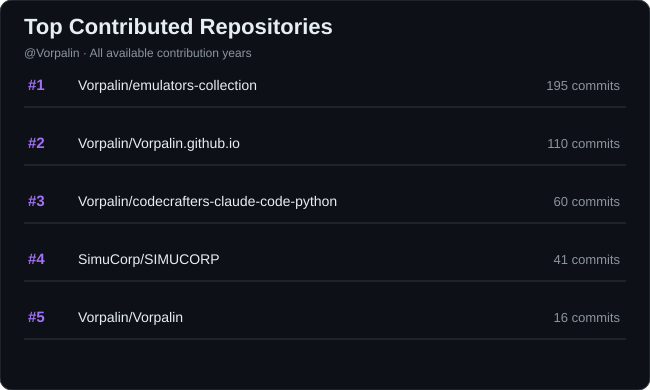

Hi, I'm Alexis 👋
🎓 Computer Science Engineering Student & Student Researcher at EPITA
I'm passionate about computer science, with a particular interest in artificial intelligence, algorithms, cryptography, and systems programming. My studies and projects span low-level development, software engineering, and AI.
🔬 Research & Teaching
Student Researcher at EPITA — Exploring cryptanalysis and S-box minimization.
Programming Teaching Assistant — Helping first-year students with C, Python, Git, and Linux, including practical assignments and code reviews.
🚀 Projects
Some areas I enjoy working on:
C/C++ Emulators — A collection of emulators built with a shared web interface.
Systems Programming — Projects involving shells, HTTP servers, and memory allocators.
Game Development — Projects using Unity and low-level programming.
Explore my repositories to learn more about what I'm building.
🌍 Open-Source Contributions
I'm interested in contributing to open-source projects, especially in AI, developer tools, and software engineering.
LangChain — Working on model profile generation to support configurable reasoning effort levels. PR #XXXX (replace with the direct PR link and update the status when available).
🧰 Tech Stack
Languages

Frameworks, Platforms & Tools

📊 GitHub Stats

🏆 GitHub Trophies

🤝 Top Contributed Repositories

🔗 Connect with Me

---

<!-- Proudly created with GPRM ( https://gprm.itsvg.in ) -->
